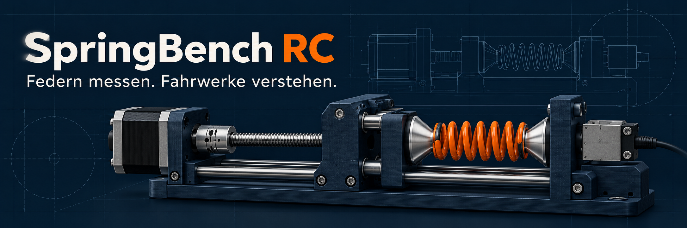

<p align="center">
  
</p>

# SpringBench RC

**Federn messen. Fahrwerke verstehen.**

SpringBench RC ist das Konzept eines überwiegend 3D-gedruckten, motorisierten Federprüfstands für RC-Fahrwerksfedern. Eine horizontal angeordnete Prüfeinheit soll die Kraft beim Zusammendrücken einer Feder messen und daraus ihre Federrate bestimmen. Ein OLED-Display zeigt Kraft, Federweg und Messergebnis direkt am Gerät an.

Im Mittelpunkt stehen Federn von 1:8-Offroad-Buggys. Wechselbare Zentriereinsätze und eine verstellbare Aufnahme sollen auch andere Federgrößen ermöglichen, beispielsweise aus dem Maßstab 1:16. Entscheidend sind die tatsächlichen Federabmessungen und Kräfte, nicht allein der Fahrzeugmaßstab.

> **Projektstatus: Konzeptphase.** Dieses README beschreibt den geplanten Aufbau. Es liegen noch keine freigegebenen CAD-Dateien, Schaltpläne, Firmware oder validierten Messergebnisse vor. Abmessungen, Bauteile und Messbereiche werden während der Entwicklung festgelegt.

## Ziel

Federfarben und Herstellerangaben lassen sich nicht immer unmittelbar vergleichen. SpringBench RC soll Federn unter gleichen Bedingungen messbar machen: Welche Feder ist härter? Wie ähnlich sind zwei Federn? Bleibt die Federrate über den Messweg konstant oder steigt sie an?

## Geplante Funktionen

- Horizontale Prüfung ausgebauter Druckfedern.
- Verstellbarer Abstand zur Aufnahme unterschiedlicher freier Federlängen.
- Wechselbare Federteller mit kurzen Zentrierkegelstümpfen für verschiedene Innendurchmesser.
- Motorischer Messhub über Schrittmotor und Gewindespindel.
- Kraftmessung mit Wägezelle und passendem Messverstärker.
- OLED-Anzeige für Kraft in N, Kompressionsweg in mm und Federrate in N/mm.
- Bedienung über Dreh-/Drückknopf und separaten Stopptaster.
- Referenzfahrt sowie softwareseitige Kraft- und Wegbegrenzung.
- Perspektivisch: Kraft-Weg-Kurven und Export der Messwerte.

## Mechanischer Aufbau

```text
Motor → Spindel → geführter Schlitten → Teller > FEDER < Teller → Wägezelle
└────────────────── steifer gemeinsamer Grundrahmen ──────────────────┘
```

Zwei Metallprofile bilden den tragenden Grundrahmen. Gedruckte Teile übernehmen Halterungen, Gehäuse, Schlittenbauteile und Federteller. Eine separate Linearführung hält den beweglichen Teller parallel zum festen Teller; die Spindel erzeugt den Vorschub.

Der Antriebsblock soll zur groben Anpassung an unterschiedliche Federlängen verschoben und sicher verriegelt werden können. Die Spindel übernimmt danach den eigentlichen Messhub. Der Block und seine Verriegelung müssen die volle Prüfkraft aufnehmen.

### Austauschbare Zentriereinsätze

Die Federenden liegen auf ebenen Tellerflächen auf. Kurze Kegelstümpfe greifen in die Federöffnungen und unterstützen die Zentrierung. Sie dürfen die Windungen nicht einklemmen oder sich am Ende des Messhubs gegenseitig berühren. Alle Einsätze erhalten eine gemeinsame Befestigungsschnittstelle.

Die Feder soll während der Messung frei bleiben und nicht auf der Grundplatte schleifen. Durchhang oder seitliches Ausknicken können den nutzbaren Prüfbereich begrenzen.

## Elektronik und Antrieb

| Baugruppe | Vorgesehene Aufgabe | Stand |
| --- | --- | --- |
| Mikrocontroller, z. B. ESP32 | Ablauf, Auswertung und Bedienung | Auswahl offen |
| Wägezelle | Erfassung der axialen Federkraft | Bauform und Messbereich offen |
| Messverstärker, z. B. HX711 | Einlesen der Wägezelle | Zu prüfen |
| Schrittmotor mit Treiber | Vorschub über Gewindespindel | Auslegung offen |
| Gewindespindel | Übersetzung von Drehung in linearen Vorschub | Steigung und Hub offen |
| OLED-Display | Anzeige von Messwerten und Menü | Größe offen |
| Endschalter | Referenzfahrt und Begrenzung | Positionierung offen |
| Stopptaster | Sofortiges Anhalten des Messablaufs | Umsetzung offen |
| Separate Wegmessung | Erfassung der tatsächlichen Tellerbewegung | Für höhere Messgenauigkeit vorgesehen |

Die Gewindespindel liefert bereits eine mechanische Untersetzung. Ein zusätzliches Getriebe wird nur bei Bedarf vorgesehen. Ein Getriebe verhindert Schrittverluste nicht zuverlässig; dafür kommen eine ausreichende Antriebsreserve und gegebenenfalls ein Schrittmotor mit Encoder infrage.

Die Wägezelle wird entsprechend ihrer vorgesehenen Belastungsrichtung montiert. Seitliche Kräfte und zusätzliche Hebelmomente sollen vermieden werden. Ein mechanischer Überlastschutz ist einzuplanen.

## Geplanter Messablauf

1. Passende Zentriereinsätze montieren und die leere Kraftmessung tarieren.
2. Feder einsetzen, groben Abstand einstellen und Antriebsblock verriegeln.
3. Druckteller langsam bis zu einer kleinen definierten Kontaktkraft verfahren.
4. Diesen Kontaktpunkt als Beginn des relativen Messwegs setzen.
5. In festgelegten Wegschritten komprimieren, jeweils kurz beruhigen lassen und Kraft sowie Weg erfassen.
6. Federrate aus der Kraftzunahme zwischen Messpunkten berechnen.
7. Bei erreichtem Prüfweg oder einer Grenzwertüberschreitung stoppen und kontrolliert entlasten.

Schrittweite, Geschwindigkeit, Kontaktkraft und Grenzwerte werden bei der Inbetriebnahme festgelegt. Die Feder darf nicht bis zum Anliegen aller Windungen zusammengedrückt werden.

## Berechnung der Federrate

Die mittlere Federrate über einen Messabschnitt lautet:

```text
k = (F₂ − F₁) / (s₂ − s₁)

k : Federrate in N/mm
F : gemessene Kraft in N
s : Kompressionsweg in mm
```

Beispiel: Steigt die Kraft zwischen 2 mm und 7 mm Kompression von 8 N auf 23 N, beträgt die mittlere Federrate in diesem Abschnitt `(23 − 8) / (7 − 2) = 3 N/mm`.

Die Kontaktvorspannung wird durch die Differenzbildung berücksichtigt. Eine einzelne Berechnung aus Gesamtkraft geteilt durch relativem Weg kann dagegen irreführend sein. Bei progressiven Federn wird die Federrate für mehrere Wegabschnitte angegeben.

## OLED-Anzeige – Entwurf

```text
SPRINGBENCH RC
Kraft      23,0 N
Federweg    7,0 mm
Rate        3,0 N/mm
Status: Messen
```

Der relative Federweg beginnt am definierten Kontaktpunkt. Die absolute Federlänge lässt sich nach einer manuellen Verstellung des Antriebsblocks nur anzeigen, wenn zusätzlich der absolute Tellerabstand bekannt ist.

## Kalibrierung und Messqualität

- Kraftmessung mit geeigneten bekannten Referenzlasten kalibrieren und über den vorgesehenen Messbereich überprüfen.
- Tatsächlichen Tellerweg prüfen; bei indirekter Wegberechnung Spindelsteigung und Vorschub kalibrieren.
- Rahmenverformung, Spiel und Verformung der Wägezelle berücksichtigen. Eine direkte Wegmessung zwischen den Tellern reduziert deren Einfluss auf die Wegbestimmung.
- Federn vor Vergleichsmessungen gleich behandeln und Messungen wiederholen.
- Ergebnisse immer zusammen mit Messabschnitt und Prüfbedingungen dokumentieren.

Eine belastbare Angabe zur Messgenauigkeit folgt erst nach Aufbau, Kalibrierung und Validierung des Prototyps.

## Sicherheit

Komprimierte Federn speichern Energie. Eine transparente Schutzabdeckung, sichere Federaufnahme, mechanische Begrenzungen und ein gut erreichbarer Stopptaster gehören zum Aufbau. Kraft- und Weggrenzen müssen zu Feder, Wägezelle und Mechanik passen. Beim Einlegen oder Wechseln von Federn darf keine unbeabsichtigte Motorbewegung möglich sein.

## Entwicklungsplan

- [ ] Federabmessungen, maximale Prüfkraft und Messhub festlegen.
- [ ] Mechanik und Verriegelung dimensionieren.
- [ ] CAD-Modell und wechselbare Zentriereinsätze erstellen.
- [ ] Wägezelle, Antrieb, Führung und Elektronik auswählen.
- [ ] Prototyp drucken und montieren.
- [ ] Kraft- und Wegmessung kalibrieren.
- [ ] Firmware mit OLED-Menü und Grenzwertüberwachung entwickeln.
- [ ] Wiederholbarkeit und Vergleichsmessungen prüfen.
- [ ] Druckdateien, Stückliste, Verdrahtung und Bauanleitung veröffentlichen.

## Geplante Repository-Struktur

```text
assets/       Logo und Banner
cad/          Editierbare Konstruktionsdateien
stl/          Freigegebene Druckdateien
electronics/  Verdrahtung und Elektronikunterlagen
firmware/     Steuerungssoftware
docs/         Bauanleitung, Kalibrierung und Messberichte
```

Aktuell enthält das Projektpaket Branding und Konzeptdokumentation. Die übrigen Inhalte entstehen im Projektverlauf.

## Mitwirken

Ideen zur Mechanik, Erfahrungen mit Wägezellen und Vergleichsmessungen sind willkommen. Für Fehlermeldungen oder Vorschläge bitte Federabmessungen, Messbereich und beobachtetes Verhalten möglichst konkret beschreiben.

## Lizenz

Eine Lizenz für Konstruktion, Software und Dokumentation ist noch festzulegen. Dieses Paket enthält daher noch keine Open-Source-Lizenzfreigabe.
